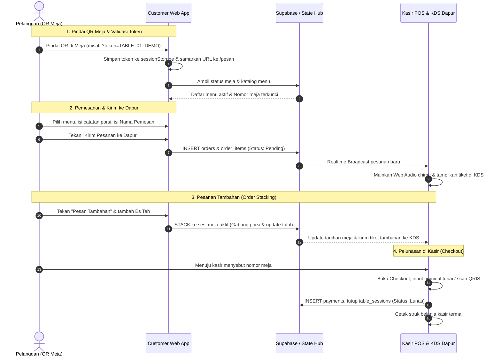

# Arsitektur Sistem & Alur Data (System Architecture)
## Sistem POS & Self-Ordering Rawon Gusti Surabaya

Dokumen ini menjelaskan rancangan arsitektur perangkat lunak, pola manajemen *state*, mekanisme sinkronisasi data *realtime*, dan mitigasi keamanan sistem terpadu (**Unified Next.js 16 Fullstack**) Rawon Gusti Surabaya.

---

## 1. Topologi Arsitektur Unified Fullstack Next.js 16

Sistem mengadopsi arsitektur terpadu berbasis **Next.js 16 App Router** dengan pemisahan tanggung jawab (*Separation of Concerns*) yang ketat:

```text
┌────────────────────────────────────────────────────────────────────────┐
│               PRESENTASI PENGGUNA (NEXT.JS 16 APP ROUTER)              │
│  React 19 + TypeScript + Tailwind CSS v4                               │
├───────────────────────────────────┬────────────────────────────────────┤
│         CUSTOMER APP              │              POS APP               │
│   (Pemesanan Mandiri QR Meja)     │    (Kasir, Waiter, KDS, Manajer)   │
│   - Rute: /pesan                  │    - Rute: /                           │
│   - Katalog Menu 2-Kolom          │    - Grid Meja 3-Kolom                 │
│   - Order Stacking Otomatis       │    - Void Audit Kasir                  │
│   - Tab Kategori Simetris         │    - KDS Sticky Station & Bel Audio    │
│   - URL Token Masking             │    - 4-Card Metric Strip Selaras       │
└─────────────────┬─────────────────┴──────────────────┬─────────────────┘
                  │                                    │
                  ▼                                    ▼
┌────────────────────────────────────────────────────────────────────────┐
│             LAYER API ROUTE HANDLERS & KEAMANAN (/api/*)               │
│  - /api/checkout/pay   : Validasi numerik & penyelesaian sesi bayar    │
│  - /api/orders         : Sanitasi token, catatan, & batched RPC        │
│  - /api/admin/staff    : Admin Bearer Token Auth & CORS Guard          │
│  - /api/reports, menu  : Pipeline analitik & query katalog aman        │
└─────────────────┬────────────────────────────────────┬─────────────────┘
                  │                                    │
                  ▼                                    ▼
┌────────────────────────────────────────────────────────────────────────┐
│             CORE DOMAIN & SERVICES (FP / FUNCTIONAL PIPELINES)         │
│  - lib/domain/billing.js         : Pure billing engine (PB1, Layanan)  │
│  - lib/domain/orderStateMachine  : Siklus hidup transisi pesanan       │
│  - lib/services/*                : Order, payment, staff, & analytics  │
│  - src/lib/supabase.ts           : Client-side realtime & SSR-safe env │
└──────────────────────────────────┬─────────────────────────────────────┘
                                   │
                                   ▼
┌────────────────────────────────────────────────────────────────────────┐
│                     BASIS DATA (SUPABASE POSTGRESQL)                   │
│  - 10 Tabel Relasional Ternormalisasi (3NF)                            │
│  - Stored Procedures / RPC (Atomic Transaction & Security Definer)     │
│  - Realtime Change Notifications & Row Level Security (RLS)            │
└────────────────────────────────────────────────────────────────────────┘
```

---

## 2. Alur Data Transaksi (End-to-End Data Flow)



---

## 3. Penanganan Pesanan Tambahan (*Order Stacking Engine*)

Salah satu keunggulan sistem ini adalah kemampuannya menggabungkan pesanan secara mulus:
1. Saat pesanan pertama dikirim, dibuat entri sesi meja aktif (`table_sessions`) dan tiket tagihan utama.
2. Ketika pelanggan menekan tombol **"Pesan Tambahan"**, sistem mendeteksi keberadaan sesi aktif yang belum lunas.
3. Menu baru digabungkan (*merged*) ke dalam daftar menu meja:
   - Jika menu dan catatan sama, kuantiti dijumlahkan.
   - Jika menu atau catatan berbeda, ditambahkan sebagai baris item baru.
4. Nilai finansial dihitung ulang secara otomatis:
   $$\text{Subtotal Baru} = \text{Subtotal Lama} + \text{Subtotal Menu Tambahan}$$
   $$\text{Biaya Layanan} = 5\% \times \text{Subtotal Baru}$$
   $$\text{Pajak Restoran (PB1)} = 10\% \times (\text{Subtotal Baru} + \text{Biaya Layanan})$$
   $$\text{Total Tagihan} = \text{Subtotal Baru} + \text{Biaya Layanan} + \text{PB1}$$
5. Kasir di meja POS langsung melihat tagihan terakumulasi secara utuh tanpa perlu menggabungkan struk terpisah.

---

## 4. Mitigasi Keamanan & Integritas Sistem

### A. Proteksi Anti-Pesan dari Luar (*URL Token Masking*)
- **Masalah**: Pelanggan yang menyalin link QR Code dapat membagikannya ke orang lain di luar restoran untuk melakukan order palsu (*prank ordering*).
- **Solusi**: Begitu halaman `/pesan` dimuat, peramban mengekstrak parameter token, menyimpannya secara eksklusif di memori tab peramban (`sessionStorage`), lalu segera membersihkan bilah alamat URL peramban menggunakan `window.history.replaceState({}, '', '/pesan')`.
- Jika URL tersebut disalin dan dibuka di perangkat atau tab lain, ketiadaan token di memori lokal akan menyebabkan akses otomatis ditolak.

### B. Proteksi Salah Klik Pembatalan Kasir (*Void Order Guard*)
- Tombol pembatalan porsi maupun meja menerapkan warna peringatan tegas **Crimson Wine** (`#ba1a1a`) dan diisolasi dalam jendela konfirmasi modal bertingkat.
- Sistem mewajibkan pencatatan alasan pembatalan untuk memelihara jejak audit kasir (*audit trail*).

### C. Keandalan Berlapis (*Resilient Offline Fallback*)
- Jika koneksi jaringan ke server Supabase mengalami fluktuasi, sistem secara otomatis beralih ke engine *optimistic state* lokal (`rg_mock_sessions_v2`).
- Kasir dan pelanggan tetap dapat melanjutkan transaksi secara mulus tanpa mengalami layar putih (*white screen of death*) atau macet di tengah antrean.

### D. Pembatasan Origin CORS & Proteksi Hak Akses Admin
- Endpoint administratif (`/api/admin/staff`) dipagari oleh verifikasi otorisasi Bearer token yang langsung memeriksa peran admin aktif di tabel `profiles`.
- Mekanisme CORS secara ketat memvalidasi daftar origin terpercaya (`STAFF_ALLOWED_ORIGINS`). Sistem tidak memantulkan origin asing (*arbitrary origin reflection*) untuk mencegah serangan Cross-Origin.

### E. Validasi Input Defensif & Pencegahan Kesalahan Relasi Null
- Seluruh endpoint mutasi (`/api/checkout/pay`, `/api/orders`) melakukan validasi ketat terhadap tipe data, keabsahan token string meja, kewajaran array keranjang, dan kepastian numerik (`Number.isFinite`).
- Data pemetaan transaksi pembayaran pada modul laporan menerapkan *optional chaining* defensif (`p.orders?.order_number`) guna mencegah insiden *runtime null pointer exception* saat data relasi kosong atau diarsipkan.
